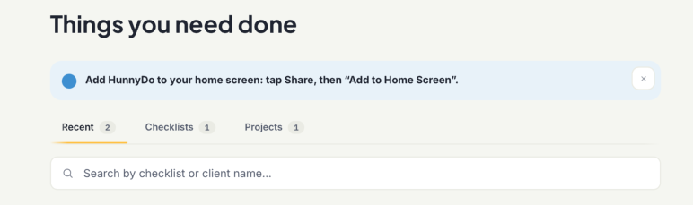

import { Image } from 'astro:assets';
import ThreeDot from '../../assets/blog/launching-our-progressive-web-app/three-dot.png'
import Share from '../../assets/blog/launching-our-progressive-web-app/ios-share.png'
import AddToHome from '../../assets/blog/launching-our-progressive-web-app/ios-add-to-home.png'
import AddSub from '../../assets/blog/launching-our-progressive-web-app/add-sub.png';
import AppHome from '../../assets/blog/launching-our-progressive-web-app/app-home.png';
import AndroidStep1 from '../../assets/blog/launching-our-progressive-web-app/android-step-1.png';
import AndroidStep2 from '../../assets/blog/launching-our-progressive-web-app/android-step-2.png';
import AndroidStep3 from '../../assets/blog/launching-our-progressive-web-app/android-step-3.png';

We have been hard at work thinking of ways to improve the general experience of
crossing off those tasks, and affording our users a higher quality experience
on mobile devices was top of mind.  There have been a handful of features native
to mobile applications that the web app was missing:

* Push notifications for task updates.
* Reading directly from device contacts.
* Using native content sharing for photos and files.

In order to provide these and other features, we are happy to announce that
HunnyDo can now be installed directly on mobile devices as a Progressive
Web Application!

## What does this mean for users
Starting today, you can opt into a native mobile app experience by simply
opting into installing the app as a PWA.  Mobile users may notice an alert banner
appearing at the top of your dashboard.

You either close this alert if you don't want to opt-in, but if you are
using HunnyDo heavily on your phone / tablet, you may want an easier way
to open the app, upload files, and share content with client and task doers.

### Enabling on iOS

This is the trickiest of the 2 platforms, Apple requires iPhone users to manually
"Add to home screen" for each device that is logged into the HunnyDo platform. It's
a few extra steps but they are something we can't avoid.

#### 1) Select the three dot menu at the bottom of the safari

<figure>
  <Image height="750" src={ThreeDot} alt="Three Dot Menu." />
</figure>

#### 2) Select the "Share" option

<figure>
  <Image height="750" src={Share} alt="iOS Share Button." />
</figure>

#### 3) From the list of options, select "Add to home screen"

<figure>
  <Image height="750" src={AddToHome} alt="Add To Home button iOS." />
</figure>

#### 4) Select the "Add" button from the submenu

<figure>
  <Image height="750" src={AddSub} alt="Add Submenu." />
</figure>

You should now see the HunnyDo Icon on your iOS Home Screen.

<figure>
  <Image height="750" src={AppHome} alt="Add appearing on Home Screen." />
</figure>

### Enabling on Android

This is very simple on Android devices.  Mobile Android users should notice a button
placed directly in the Alert banner that should handle the installation.  All you'll 
have to do is approve the request from your mobile device.

#### 1) Alert banner should inform you an install is available.

<figure>
  <Image height="750" src={AndroidStep1} alt="Clicking install from Alert Banner." />
</figure>

#### 2) Approve the installation 

<figure>
  <Image height="750" src={AndroidStep2} alt="Confirm the installation." />
</figure>

Once approved, the app should appear within your application list.

<figure>
  <Image height="750" src={AndroidStep3} alt="Application icon appears in application list." />
</figure>

We hope this provides a better experience on mobile and feel free to leave us a comment to let us know what you think!
